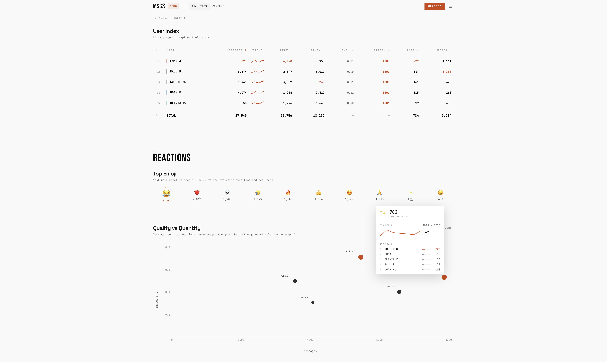

# MSGS

**Rediscover your Messenger & Instagram chats.**

MSGS analyzes your Facebook Messenger and Instagram DM exports entirely in the browser — no data ever leaves your device.



## Features

- **Analytics** — activity heatmaps, messaging frequency, reactions, per-user breakdowns
- **Content** — word clouds, sentiment analysis, top phrases, vocabulary stats, word trends
- **Wrapped** — a Spotify Wrapped-style yearly highlight reel, shareable per person

## Tech stack

| Layer | Choice |
|---|---|
| Framework | React 18 + Vite |
| Styling | Tailwind CSS |
| Charts | Recharts |
| Backend | None — 100% client-side |

Parsing, aggregation, and all analytics run in the browser. Nothing is uploaded anywhere.

## Running locally

```bash
cd frontend
npm install
npm run dev
```

Open http://localhost:5173. Demo data loads by default so you can explore without your own files.

## Getting your data

### Facebook Messenger

1. Go to [Facebook → Settings → Your Facebook information → Download your information](https://www.facebook.com/dyi/)
2. Select **Messages**, format **JSON**, date range **All time**
3. Download and unzip the archive (`your_facebook_activity-N/` folders)
4. Drag the extracted folder(s) into MSGS

### Instagram DMs

Same flow via [Instagram → Settings → Your activity → Download your information](https://www.instagram.com/download/request/) — select **Messages** and **JSON**.

## Deploying

The app is a static SPA. It deploys to Vercel with zero config:

[](https://vercel.com/new/clone?repository-url=https://github.com/YOUR_USERNAME/msgs&root-directory=frontend)

`frontend/vercel.json` is already configured for client-side routing.

> **Note:** `@vercel/analytics` is included for the hosted demo. If you self-host and don't want Vercel's page-view tracking, remove the `<Analytics />` component from `src/App.jsx` and uninstall `@vercel/analytics`.

## Privacy

- All processing happens locally in your browser
- Sessions are optionally saved to `localStorage` for convenience
- Clear browser data at any time to remove all traces
- No accounts, no servers, no telemetry (except Vercel Analytics on the hosted demo — see above)

## Project structure

```
frontend/
├── src/
│   ├── features/
│   │   ├── analytics/   # Activity, reactions, evolution, user stats
│   │   ├── content/     # Word analysis, sentiment, phrases
│   │   └── wrapped/     # Story-based yearly Wrapped experience
│   ├── utils/
│   │   ├── parseMessenger.js      # Core parser — reads Facebook/IG JSON exports
│   │   ├── aggregatesToProcessed.js
│   │   └── analytics/             # Temporal, user, creative analytics
│   ├── components/      # Shared UI (charts, layout, modals)
│   ├── hooks/           # useDataLoader, useFilters
│   └── data/
│       └── demoData.js  # Seeded synthetic data for the demo
└── public/
```

## License

MIT
